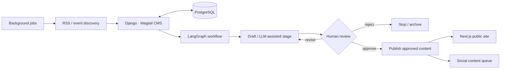

# Bliżej Walencji — Editorial AI Engineering Portfolio Demo

[**Live demonstration**](https://paulinap92.github.io/blizej-walencji-demo/) *(available after the repository is created and Pages is enabled)* · [Production product](https://blizejwalencji.es)

> **Safe, independently implemented portfolio demo.** Event records and texts are fictional. It does not perform online discovery, call LLMs, access a CMS or post to any social platform.

## Authentic product screenshots

Two **real screenshots of the public production homepage**, captured by the project owner with Playwright on **November 26, 2026**, are included in `screenshots/`:

- [Desktop — 1440 × 900](screenshots/production-desktop.png)
- [Mobile — 390 × 844](screenshots/production-mobile.png)

They appear responsively in the hero and in the expandable screenshot gallery, with links to the original PNG files. Capture provenance is recorded in [screenshots/capture-metadata.json](screenshots/capture-metadata.json) and the [screenshot gallery documentation](docs/production-screenshots.md). Screenshots show the **real public product**, while the surrounding interactive portfolio demo uses **fictional offline data**.

To capture updated public screenshots on Windows using `uv`:

```powershell
uv run --with playwright python -m playwright install chromium
uv run --with playwright python tools/capture_public_site.py
```

Review any new captures before publishing. The helper opens the public homepage only and does not authenticate to a CMS or access production Studio.

## Real source excerpt (selected, non-secret)

The architecture section contains a short excerpt from **backend/news/workflow.py**, with formatting simplified for readability. Additional small samples are in [docs/source-excerpts.md](docs/source-excerpts.md). The real repositories, prompts, database credentials, and operational implementation remain private.

## Features you can interact with

| Section | Interactive demonstration |
| --- | --- |
| Portal | Editorial-style homepage and fictional regional events |
| Event discovery | Query, city/category filtering and example ranking |
| AI Content Studio | Choose source → simulate draft → edit → mandatory HITL approval/rejection → publication preview + local social copy |
| Background jobs | Run simulated RSS/event/review/social workflows and view local execution logs |
| Architecture | Django/Wagtail, LangGraph, PostgreSQL, Next.js, delivery and job boundaries |

**Production-oriented technical scope:** Django, Wagtail, PostgreSQL, Next.js, event discovery, deduplication, background jobs, LangGraph-style orchestration, LLM-assisted drafts, human-in-the-loop controls, and social distribution.

The public demonstration runs on **vanilla JavaScript** so GitHub Pages can host it without Python, a real LLM, source API keys, or database credentials. The stage display simulates a LangGraph **concept**; it is not an actual running LangGraph graph. The real application architecture is described rather than exposed.

## System architecture



See [architecture notes](docs/architecture.md) and [security boundary](SECURITY.md).

## Language policy

The public user interface uses **Polish** for the target audience. Technical documentation, source identifiers, code comments, test descriptions, Git commit messages, and architecture notes are in **English**. Fictional editorial content follows the interface language.

## Local development

```bash
python -m http.server 8000
# http://localhost:8000
```

Run tests using `npm test` (Node.js 20+, no dependencies).

## GitHub Pages deployment

1. Create a public repository named `blizej-walencji-demo` under `paulinap92`.
2. Push the **contents of this directory** to `main`.
3. Configure **Settings → Pages → Build and deployment → Source: GitHub Actions**.
4. The workflow in `.github/workflows/pages.yml` validates and publishes the site.

No production code, live credentials, internal prompts, source collection strategies, private schemas, authentication or publishing endpoints are exposed.

## Engineering story

The editorial system separates discovery, generation, human approval and publication. A deliberate approval checkpoint prevents unreviewed model output from being treated as published news. The UI helps explain this design to engineering interviewers while keeping operational code private.
