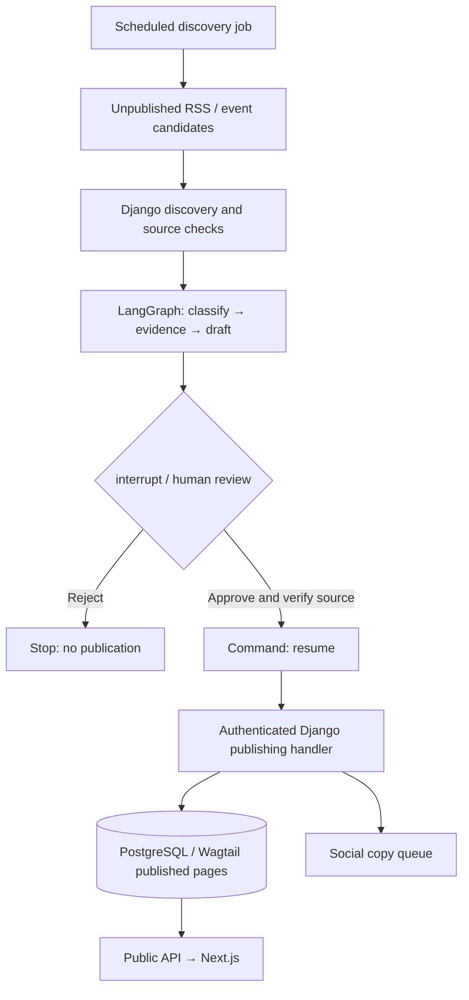

# Bliżej Walencji · AI Workflow Engineering Case Study

**Interactive technical portfolio:** [Live demo](https://paulinap92.github.io/blizej-walencji-demo/) · [Real production portal](https://blizejwalencji.es)

This is an **English-language engineering walkthrough**, not a clone of the Polish-language portal. It demonstrates the technical workflow behind event research and AI-assisted publication using an interactive LangGraph-style state machine, human approval controls, code excerpts and system-boundary tests.

## What you can actually try

| Module | Interactive behavior | Architectural interpretation |
| --- | --- | --- |
| LangGraph visualization | Click nodes; advance discovery → classify → evidence → draft → review | Based on real `StateGraph` node ordering |
| HITL checkpoint | Pause, manually verify source, edit, approve or reject | Models `interrupt()` / `Command(resume=...)` |
| Checkpoint inspector | Watch the `EditorialState`-style JSON evolve | **Local JavaScript only**, not a real Postgres checkpoint |
| Event discovery | Select fictional candidates, replay screening and duplicate flags | Follows discovery vs. publication separation |
| Django publication | Inspect refusal of unreviewed content or a public API response | Publishing occurs only in a separate authenticated Django handler |
| Code browser | Small LangGraph, review, Django, YAML and JavaScript samples | Real structural snippets, adapted/redacted as marked |

**Important limitation:** this GitHub Pages app does **not** execute LangGraph Python, Django, Wagtail, an LLM, PostgreSQL, online event discovery or social publishing. The interactions are deterministic browser simulations using fictional examples. The real application is linked separately.

## Technologies in the real system

`Python` · `Django` · `Wagtail CMS` · `LangGraph` · `PostgreSQL` · `Next.js` · `GitHub Actions` · `LLM-assisted drafting` · `HITL`

## Architecture and decision boundary



**Key distinction:** the actual editorial `StateGraph` ends after the human-review decision. Publishing is performed by a separate authenticated Django handler; there is no automatic publishing node in the graph.

## What is shown and what is private

The graph structure is a trimmed source excerpt. The HITL checkpoint and Django snippets are redacted/adapted to omit private integration details. Full prompts, model credentials, production endpoints, internal data schemas and operational source configurations are not included. Candidate records, draft summaries, JSON states and job traces in the interactive demo are fictional.

## Real product reference

Optional Playwright captures of the real public homepage are in `screenshots/production-desktop.png` and `screenshots/production-mobile.png`. They are available only in the collapsed reference section; the portfolio focuses on processes and code.

## Run locally

```bash
python -m http.server 8000
# open http://localhost:8000
node --test tests/*.test.js
```

The `pages.yml` workflow tests and deploys this standalone browser demo to GitHub Pages. It does not publish to the real CMS or run any backend automation.

## Design priorities

- Evidence provenance: source discovery is not independent verification.
- LLM output remains a draft until a human checks it.
- Checkpointed review is resumable using a stable thread identifier.
- Approval and publication are distinct security boundaries.
- No hallucinated event dates or synthetic performance claims are presented as production metrics.
- English-only engineering presentation, documentation, code comments and commit messages.

**Portfolio focus:** LangGraph, human-in-the-loop AI, backend integration and operational guardrails, not a copy of the public portal.
