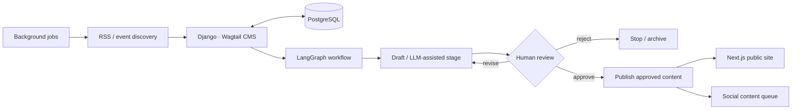

# Bliżej Walencji — Architecture (public-safe)

This is an **architectural overview**, not proprietary source code or an exact infrastructure inventory.

## Boundaries

- Browser demonstration: static HTML/CSS/JavaScript with synthetic records.
- Real product: https://blizejwalencji.es. The architecture reflects high-level technological responsibilities verified against the project, not a claim that GitHub Pages executes Python.
- **Not included:** application servers, operational endpoints, schemas from production, prompts, credentials, proprietary algorithms, internal scheduler settings, production data or admin access.
- Job and AI controls on the demonstration are local deterministic simulations. They neither issue provider requests nor publish anything.
